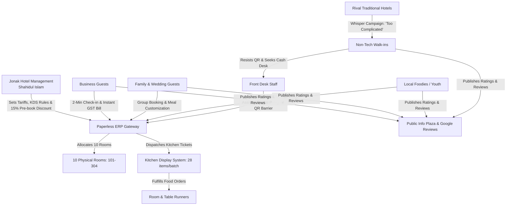

# Title: Jonak Hotel & Restaurant - Smart Room Booking & Digital Food Service Rollout
**Project:** Jonak Hotel & Restaurant, Barpeta, Assam (100% Paperless Smart Hotel ERP Rollout)  
**Framework:** 666ghj/MiroFish Multi-Agent Simulation Pipeline  
**Evaluation Window:** 4 Weeks (30-Day Peak Festive & Wedding Season / 15 Simulation Rounds)

---

## 1. Background & Operating Context
Jonak Hotel & Restaurant operates on a 100% paperless smart hotel ERP system located on BH Road, near NRL Petrol Pump, Donakuchi / Garemara Pathar, Barpeta, Assam 781314. Every room booking, check-in, and restaurant table order is handled digitally via QR codes and an integrated responsive web app. 

The property comprises 10 physical rooms across 3 floors and an 82-item multi-cuisine restaurant serving traditional Assamese cuisine, Dum Biryanis, Tandoori dishes, rolls, and momos.

---

## 2. Key Offerings & Rules Tested in Simulation

1. **Room Booking Tiers & Tariffs:**
   - **Standard Room:** Rs. 1,200 / night (Single/Twin Non-AC, Rooms 302, 303, 304).
   - **Deluxe Room:** Rs. 2,000 / night (Executive AC Double & Single AC, Rooms 201, 202, 203, 301).
   - **Executive Suite:** Rs. 3,200 / night (Presidential & Executive Suites 101, 102, 204).
   - **Dinner Pre-booking Incentive:** A **15% discount** is offered on food if guests pre-book their dinner meal while completing their digital check-in.
   - **Smart Package Option (Scenario A):** "Stay + Unlimited Breakfast/Dinner" combo (+Rs. 450/night Single, +Rs. 750/night Double/Suite) tested against pure à la carte pricing.

2. **Digital Restaurant Menu & Paperless Operations:**
   - **Zero Physical Menus:** Laminated paper cards and physical KOTs are completely decommissioned.
   - **Table & In-Room QRs:** Guests scan table-specific QRs (Tables 1–15) or room QRs (`?room=101` to `?room=304`).
   - **Direct KDS Dispatch:** Orders dispatch directly into the Kitchen Display System (KDS).
   - **Digital Payment:** Instant settlement via Paytm UPI (`paytm.s1i7is2@pty`) or card; zero paper receipts.

3. **Peak Hour Policy (Scenario B):**
   - **Peak Window:** 7:30 PM to 9:30 PM on weekend and festive evenings.
   - **Delivery Time Guarantee:** Room service food orders carry an official 35-minute estimated delivery time due to heavy walk-in dining hall congestion.

4. **100% QR-Mandatory Policy (Scenario C):**
   - Eliminates physical check-in registers and paper menus entirely, forcing camera QR scans on all guests. Tested against an "Assisted Front-Desk Tablet" proxy hybrid.

---

## 3. Active Stakeholders (Entities) & Knowledge Graph Ontology

### Entity Profiles:
- **Jonak Management (Proprietor Shahidul Islam):** Focused on zero revenue pilferage, fast table turnaround, high RevPAR, and 100% inventory accuracy without paper waste.
- **Front-Desk Staff:** 2 daytime receptionists, 1 night manager. Manages physical key handovers, government ID checks, and guest digital onboarding.
- **Kitchen & F&B Staff (KDS Team):** 1 Head Chef, 2 Line Cooks, 2 Prep Assistants, 2 Runners. Optimal throughput: 28 concurrent dishes per 20-minute cycle.
- **Business Guests (Persona 1):** Frequent travelers visiting FAAMCH and Barpeta commercial centers. Want 2-minute digital check-in, automated GST bills, dependable Wi-Fi, and punctual 7:30 AM in-room breakfast.
- **Family & Wedding Guests (Persona 2):** Large groups attending Barpeta Satra festivals or marriages. Want clean spacious rooms, kids' mild meals, combo savings, and human warmth alongside digital tech.
- **Local Foodies / Walk-in Customers (Persona 3):** Evening diners from Barpeta Govt College and nearby towns. Highly vocal on Google Reviews and local social media regarding Biryani taste, portions, and speed.
- **Non-Tech Walk-in Guests (Persona 4):** Senior Satra pilgrims and rural traders. Prefer cash, printed bills, and human conversation; encounter immediate friction when forced to scan phone QRs.
- **Rival Traditional Hotels (Competitor Agents):** Nearby legacy lodges ('Hotel Satra View', 'Barpeta Grand Dhaba') spreading word that Jonak's system is "too complicated, tracks personal data, and rejects cash."

---

## 4. Test Scenarios Injected Across 15 Simulation Rounds

- **Scenario A (Rounds 5–8): Smart Room + Food Combos with 15% Pre-book Discount:**
  Evaluates guest willingness to bundle dinner at check-in for a 15% discount or adopt the "Royal Feast Unlimited Breakfast/Dinner" package.
- **Scenario B (Rounds 3, 7, 11, 15): Friday Peak-Hour Rush Contention (7:30 PM – 9:30 PM):**
  Spikes dine-in tables to 14 active parties while 7 in-room dining orders hit KDS simultaneously. Tests the 35-minute delivery SLA and identifies guest churn thresholds.
- **Scenario C (Rounds 12–14): Strict 100% QR Mandatory vs. Assisted Hybrid:**
  Enforces zero-paper check-in and table ordering without staff intervention. Round 15 introduces the "Assisted Tablet Proxy" to measure recovery.

---

## 5. Simulation Metric Targets
1. **Public Sentiment & Star Rating:** Trajectory across 1.0 to 5.0 stars on Google Reviews / Info Plaza.
2. **Repeat Booking & Loyalty Rate:** Percentage of business and family travelers willing to book a repeat stay.
3. **Queue Latency & Churn Point:** Wait times (in minutes) where dine-in and room guests post 1-star reviews.
4. **Revenue Mix:** Net room sales vs. food sales vs. bundled package add-ons.
5. **Walk-in Abandonment:** Lost bookings due to digital barriers.
